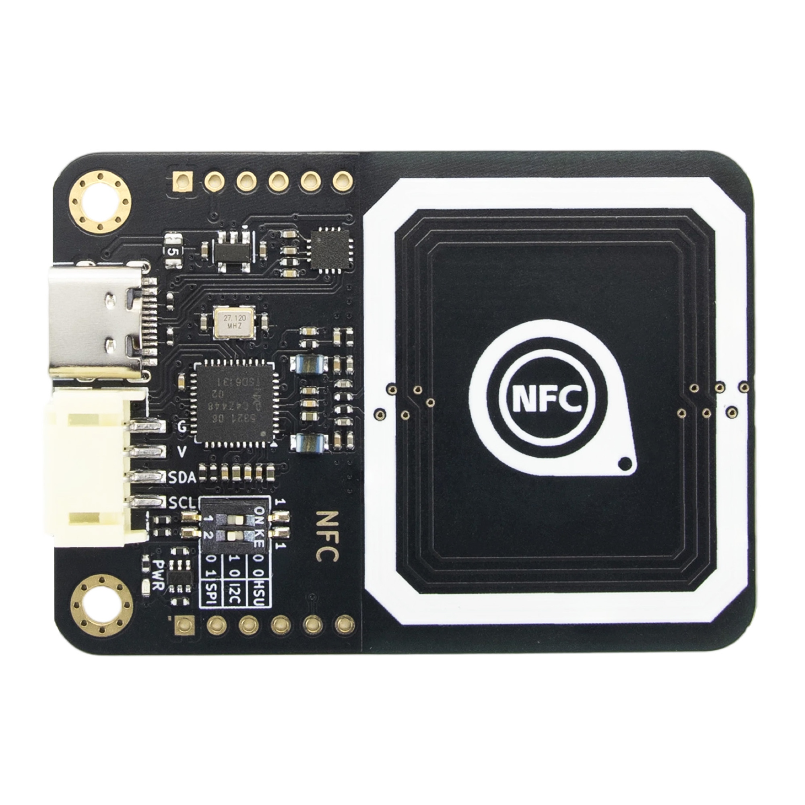
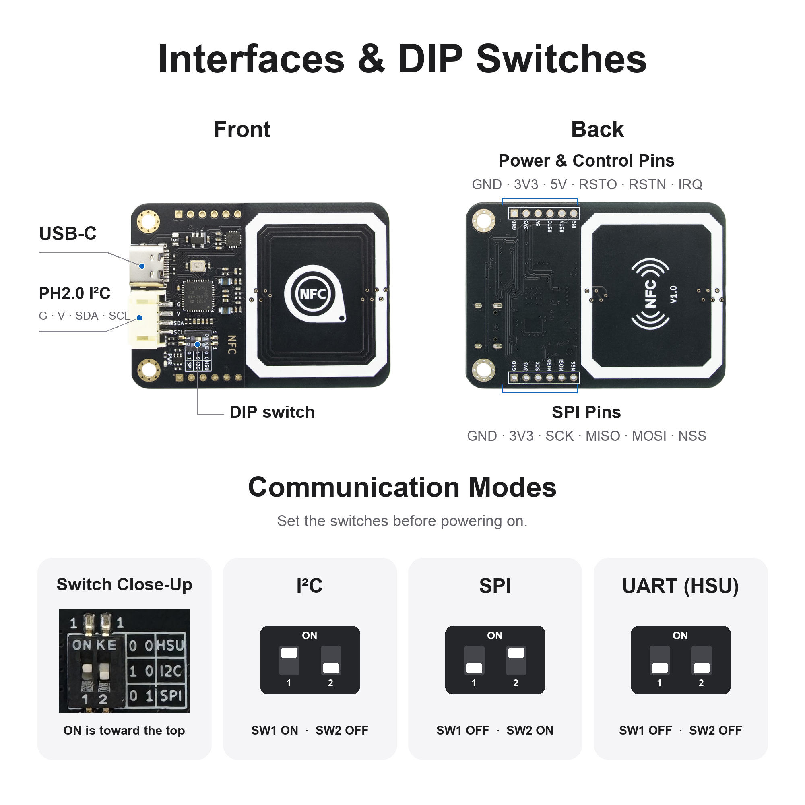

# PN532 NFC Reader/Writer Module

A 13.56 MHz NFC module based on the NXP PN532. Use the onboard USB-C port to test the module on a computer, or connect it to a development board for an embedded NFC project.

## Set the interface

Disconnect power before changing the DIP switches. Use the printed **ON** mark and the numbers **1** and **2** on the switch body as your reference.

| Interface  | Switch 1 | Switch 2 |
| ---------- | -------- | -------- |
| UART (HSU) | OFF      | OFF      |
| I²C       | ON       | OFF      |
| SPI        | OFF      | ON       |

## Quick start on a computer

1. With the module unplugged, set both switches to **OFF** for HSU.
2. Connect the module’s USB-C port to the computer using the included data cable.
3. Open the [PN532 Web Serial Tester](https://www.elechouse.com/pn532-tester/) in desktop Chrome or Edge.
4. Select **115200 baud**, click **Connect serial port**, and choose the module’s serial port.
5. Click **Get firmware version**, then **Initialize PN532**.
6. Hold one card over the antenna and click **Start polling**. The card’s UID appears when the module detects it.

The browser tester checks serial communication and reads ISO 14443-A card UIDs. To write tag data, use software that supports both the PN532 interface and the specific tag type.

## Arduino Uno over I²C

With both boards disconnected from power, set **SW1 ON** and **SW2 OFF**. Use the PH2.0 connector on the module and follow the PCB labels when attaching the four Dupont leads.

| Module label | Arduino Uno |
| ------------ | ----------- |
| G            | GND         |
| V            | 5V          |
| SDA          | A4 / SDA    |
| SCL          | A5 / SCL    |

Install **Adafruit BusIO** from Arduino IDE’s Library Manager. Open the [PN532_Test sketch](examples/PN532_Test/PN532_Test.ino) with the other files in its folder, select **Arduino Uno** and the board’s serial port, and upload. Open Serial Monitor at **115200 baud**, then hold a card over the antenna to read its UID.

The bundled driver checks I²C readiness by polling. The sketch keeps the original D2 (IRQ) and D3 (reset) assignments. Leave those Arduino pins free when using the four-wire connection above. 

For other hosts, check the board’s GPIO voltage and pinout, and select a PN532 library that supports the chosen interface. The table above is specific to the Arduino Uno.

## Android USB connection

**RFID Tools** is a third-party Android app from RFID Research Group. Use a compatible Android phone with USB Host (OTG) support. Set the module to **HSU** before connecting it with a USB-C to USB-C data cable (sold separately). Use the app with the external PN532 to read a card UID. [RFID Tools on GitHub](https://github.com/RfidResearchGroup/RFIDtools)

## Compatible cards and tags

| Family            | Supported types           |
| ----------------- | ------------------------- |
| MIFARE Classic    | 1K, 4K                    |
| MIFARE Ultralight | Ultralight                |
| NTAG              | NTAG213, NTAG215, NTAG216 |

These entries describe module compatibility. The chip model of the included blank cards has yet to be confirmed. Write access depends on the tag, its settings, and the software.

## Module specifications

| Specification         | Value                                       |
| --------------------- | ------------------------------------------- |
| NFC controller        | NXP PN532                                   |
| Operating frequency   | 13.56 MHz                                   |
| Module supply voltage | 3–5 V                                      |
| Board dimensions      | 56 × 40 mm (2.20 × 1.57 in)               |
| Host interfaces       | I²C, SPI, high-speed UART (HSU)            |
| Default I²C address  | `0x24` (7-bit)                            |
| Default HSU baud rate | 115200                                      |
| NFC modes             | Reader/writer, card emulation, peer-to-peer |

Card emulation and peer-to-peer operation require compatible software.
